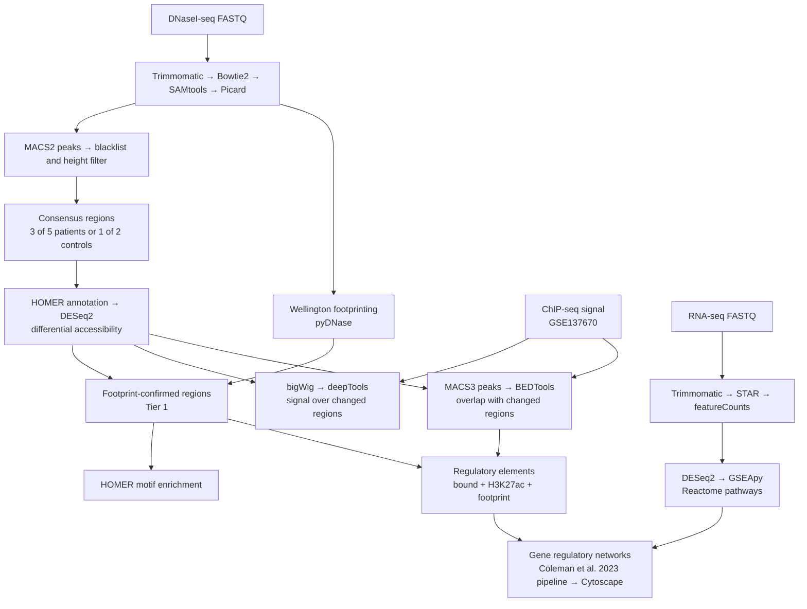
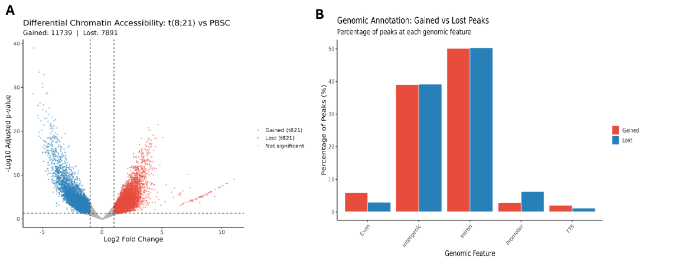
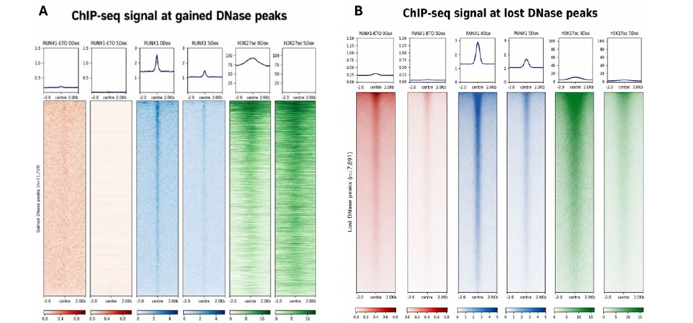
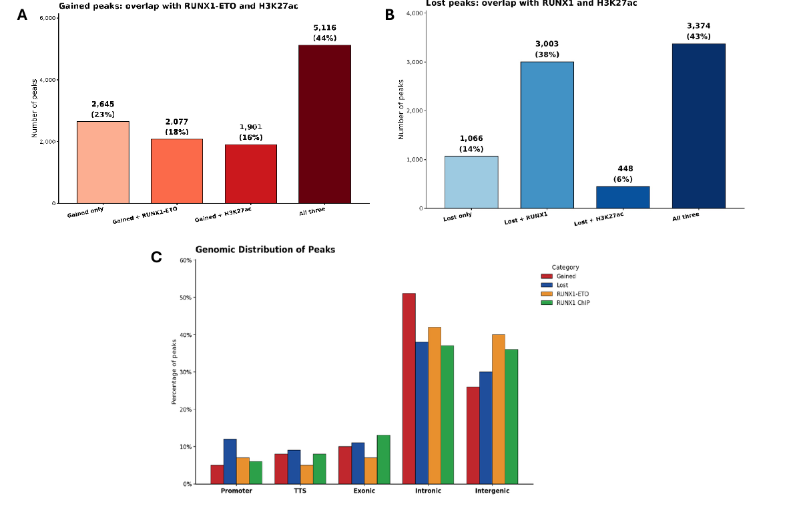
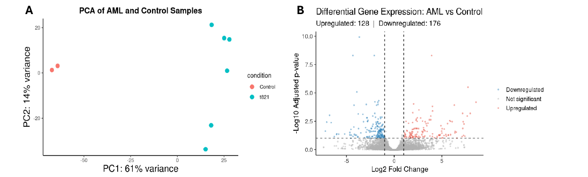
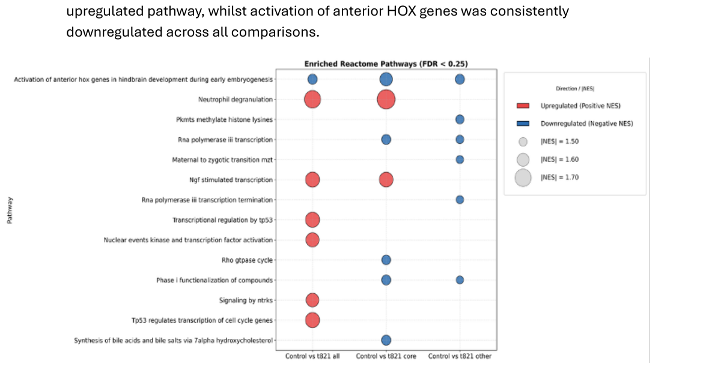
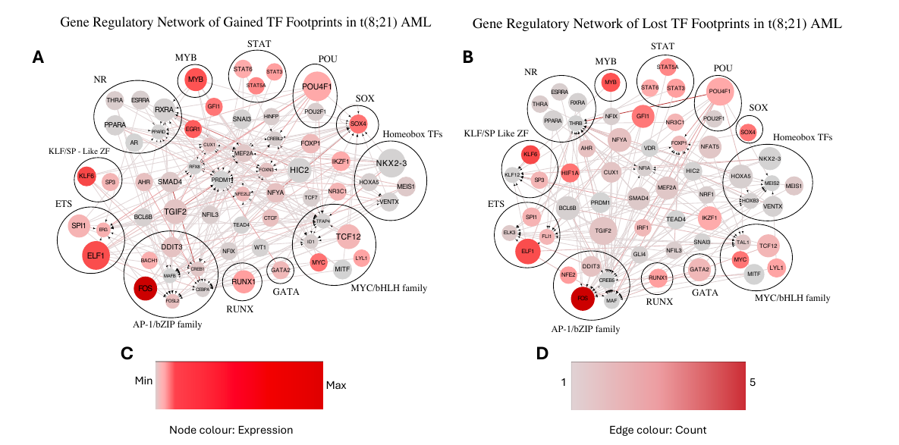

# How RUNX1-ETO re-wires gene regulation in t(8;21) acute myeloid leukaemia

A research project from my MSc Bioinformatics at the University of Birmingham
(2025–26), supervised by Dr Peter Keane.

We combined three types of sequencing data from patients and published experiments
to ask how the RUNX1-ETO fusion protein changes the gene regulatory network of
leukaemia cells.

## Background

About 15% of acute myeloid leukaemia (AML) cases carry the t(8;21) translocation,
which fuses *RUNX1* to *RUNX1T1* (ETO). The fusion protein still binds RUNX1's DNA
sites but recruits repressors instead of activators, blocking normal blood cell
differentiation. Most of what is known comes from cell-line models; in patients it
is harder to see, because they usually carry other mutations as well.

We compared t(8;21) AML patients with healthy blood stem cells and asked:

1. which regions of the genome open or close, and which transcription factors bind there
2. how the gene regulatory network differs between regions that gain and lose accessibility
3. which pathways change in gene expression

## Data

| Data | Samples | Source |
|---|---|---|
| DNaseI-seq (open chromatin), single-end | 5 t(8;21) patients, 2 healthy PBSC controls | Patient cohort from Assi et al. (2019), provided by our supervisor |
| RNA-seq (gene expression), paired-end | 6 t(8;21) patients (one with DNaseI missing), 2 PBSC controls | as above |
| ChIP-seq: RUNX1-ETO, RUNX1, H3K27ac, Input | inducible RUNX1-ETO cell model, before and after 5 days of induction | [GEO GSE137670](https://www.ncbi.nlm.nih.gov/geo/query/acc.cgi?acc=GSE137670) (Nafria et al. 2020) |

PBSC = peripheral blood stem cells. The sequencing files are around 2 GB each and the
patient data are not mine to share, so **no data are stored in this repository**.
The scripts, figures and results are.

## Pipeline



## My role

My own work in this project was the **DNaseI-seq pre-processing** (trimming,
Bowtie2 alignment, BAM sorting and indexing, duplicate removal) and the **ChIP-seq
integration** (converting the GEO signal tracks, measuring RUNX1-ETO, RUNX1 and
H3K27ac signal over the changed regions, and the overlap analysis). The repository
documents the full pipeline so the results can be followed from raw reads to networks.

All analysis ran on the University of Birmingham BlueBEAR HPC cluster using Slurm job scripts.

## Results

### 1. Thousands of regulatory regions change in patients

Of 97,368 consensus regions, **19,630 changed accessibility** (adjusted p < 0.05,
|log2FC| > 1): 11,739 opened and 7,891 closed in t(8;21) patients. Most lie in introns
and intergenic regions, where enhancers sit, rather than at promoters.



Opened regions were enriched for **AP-1 motifs** (Fra1, Fra2, JunB) and **C/EBP**;
closed regions for **GATA** and **HOX** motifs (HOXA1, HOXC9, PBX2, CDX4), consistent
with a switch away from normal differentiation programmes.

About **41%** of both opened and closed regions contained a DNaseI footprint
(4,835 and 3,274 regions), meaning a transcription factor was bound there.

### 2. RUNX1 loses its enhancers; RUNX1-ETO activates others indirectly



- **Closed regions** carry strong RUNX1 and H3K27ac signal that drops once RUNX1-ETO
  is switched on: normal RUNX1-bound enhancers are being shut down.
- **Opened regions** gain H3K27ac (an active-enhancer mark) but carry little direct
  RUNX1-ETO signal, so they are probably activated indirectly, through other factors.



44% of opened regions overlap both RUNX1-ETO and H3K27ac peaks, and 43% of closed
regions overlap both RUNX1 and H3K27ac. These overlapping regions, filtered for
footprints, became the regulatory elements of the networks.

### 3. Gene expression changes

Patients and controls separate clearly by PCA (PC1 61% of variance). We found **304
differentially expressed genes** (128 up, 176 down). Comparing differentially
expressed genes with genes near DNaseI footprints found **65 genes changed at both
levels**, and on those genes patients without a second mutation or relapse cluster
apart from those with one.



**Neutrophil degranulation** was the most strongly upregulated pathway, and
**activation of anterior HOX genes** was downregulated in every comparison.



### 4. Re-wired gene regulatory networks



The network of opened regions (63 factors, 214 connections) is more densely
connected than that of closed regions (61 factors, 135 connections). Factors such as
MYC, FOS and ELF1 appear in both, with different connections, which suggests
RUNX1-ETO redistributes where existing factors bind rather than replacing them.

## Repository layout

```
config.sh                                 paths and sample names used by every script
scripts/
  01_dnase_preprocessing/   01–05         trimming, Bowtie2 index and alignment, BAM, duplicates
  02_dnase_peaks/           06–09         MACS2, filtering, consensus regions, HOMER annotation
  03_differential_accessibility/          DESeq2 on DNase signal, volcano and annotation plots
  04_footprinting/          10–12         Wellington footprints, footprint tiers, HOMER motifs
  05_chipseq_integration/   13–16         bigWig, deepTools heatmaps, ChIP peaks, overlaps
  06_rnaseq/                17–20         Trimmomatic, STAR, featureCounts, DESeq2, GSEA
  07_gene_regulatory_network/             how the networks were built (Coleman et al. 2023)
figures/                                  figures from the project report
tests/                                    end-to-end test on simulated data
```

## Running it

The shell scripts are Slurm jobs written for BlueBEAR (`module load` lines name the
exact tool versions). Set `PROJECT_DIR` in `config.sh`, then submit from the
repository root in numbered order, for example:

```bash
sbatch scripts/01_dnase_preprocessing/03_bowtie2_align.sh   # one array task per sample
Rscript scripts/03_differential_accessibility/differential_accessibility.R "$PROJECT_DIR"
```

The downstream steps can be checked without the real data:

```bash
bash tests/run_tests.sh
```

This simulates peaks, signal and counts, then runs filtering, consensus regions,
differential accessibility, footprint tiers, the ChIP overlap, DESeq2 and GSEA.

### Software

FastQC, Trimmomatic 0.39, Bowtie2 2.5.4, STAR 2.7.11b, SAMtools 1.21, Picard 3.4.0,
MACS2 2.2.9.1, MACS3 3.0.1, BEDTools 2.31.1, HOMER 4.11, pyDNase 0.3.0,
deepTools 3.5.2, Kent tools, Subread 2.0.4, R (DESeq2, GenomicRanges, ggplot2,
pheatmap), Python (GSEApy, pandas), Cytoscape.

## Notes on the code

The commands come from the project's working notes and job scripts. I collected
them into one script per step, replaced the cluster paths with the variables in
`config.sh`, turned per-sample jobs into Slurm array jobs, and added comments. Two
steps are written down from the report's methods rather than copied from saved
code: DNase trimming (the same Trimmomatic settings as RNA-seq, in single-end mode)
and the DESeq2 call on the DNase signal. The network-building scripts belong to our
supervisor's group and are described rather than included.

## Limitations

- The ChIP-seq data come from an inducible cell-line model, which may not match
  binding in patient cells.
- Only two healthy controls against five or six patients limits statistical power.
- Few patients carried an extra mutation or had relapsed, so the subgroup
  comparisons are exploratory.

## Key references

- Assi SA et al. (2019) Subtype-specific regulatory network rewiring in acute myeloid leukemia. *Nature Genetics* 51:151–162.
- Coleman DJL et al. (2023) Gene regulatory network analysis predicts cooperating transcription factor regulons required for FLT3-ITD+ AML growth. *Cell Reports* 42:113568.
- Nafria M et al. (2020) Expression of RUNX1-ETO rapidly alters the chromatin landscape and growth of early human myeloid precursor cells. *Cell Reports* 31:107691.
- Piper J et al. (2013) Wellington: a novel method for the accurate identification of digital genomic footprints from DNase-seq data. *Nucleic Acids Research* 41:e201.
- Ramírez F et al. (2016) deepTools2. *Nucleic Acids Research* 44:W160–W165.
- Love MI, Huber W, Anders S (2014) DESeq2. *Genome Biology* 15:550.
- Fang Z, Liu X, Peltz G (2022) GSEApy. *Bioinformatics* 39:btac757.
